# WireShark Packet Capturing

Capturing network traffic in Wireshark and reading it to answer SOC-style questions like; who is attacking ?, what they are attacking ?, and what a person on the same network can see. I did this as a set of hands-on Wireshark SOC labs from Networkwalks during my Cybersecurity Internship.

The labs were optional. I did them anyway to upskill, to learn how to capture packets, and to get comfortable with the Wireshark interface after watching the Wireshark video course the labs link to.

## The Lab Details 

| Item | Detail |
|---|---|
| Tool | Wireshark |
| Where it ran | A Windows 11 PC inside the Networkwalks lab (I signed in to it from the lab page) |
| Labs covered | Lab 3 to Lab 8 (six labs) |
| Format | 10 tasks per lab, 10 marks each, 100 marks per lab |
| Dates | 31 October 2026 (Labs 3 to 7) |
| Prep | Wireshark Full Course with Practice Labs (video playlist linked from each lab) |

## Starting point: the lab login page

Every lab starts the same way. The lab shows a Windows sign-in screen for a user called "Student". Task 1 of each lab is to sign in, start Wireshark and capture the traffic, then report how many packets were captured. The sign-in hint shown under the password box is blurred out in this screenshot.

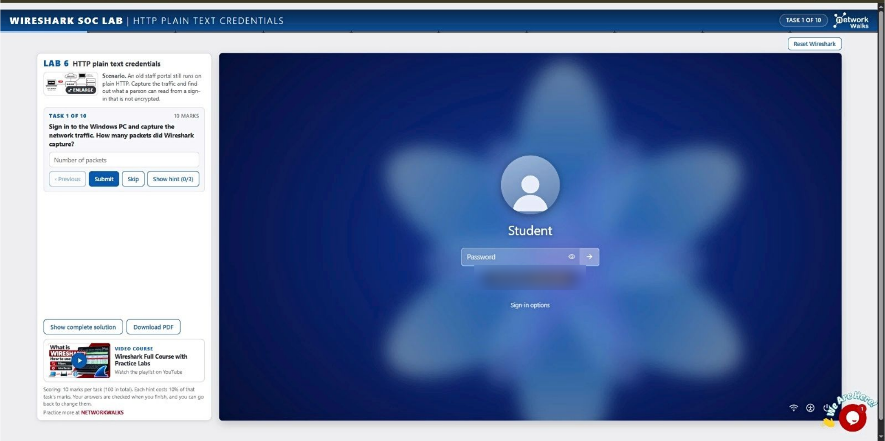

## Lab 3: Identify the Attacker's IP

**What it is meant to do:** a staff member reported unusual traffic to the company's web server. I capture the traffic, analyse it in Wireshark, and find out who the attacker is and what kind of attack it is.

**What I found**

- 309 packets captured.
- Attacker: 192.168.10.66. Target: 192.168.10.20.
- The attacker used one source port (52311) and probed 40 different ports on the target. One source, many destination ports is the signature of a port scan.
- Open ports (22, 80, 443) answered the SYN with SYN,ACK. Closed ports answered with RST,ACK. 37 ports were closed.
- Attack type: port scan.

I used Statistics > Conversations (TCP tab) to see every connection from the attacker in one table.

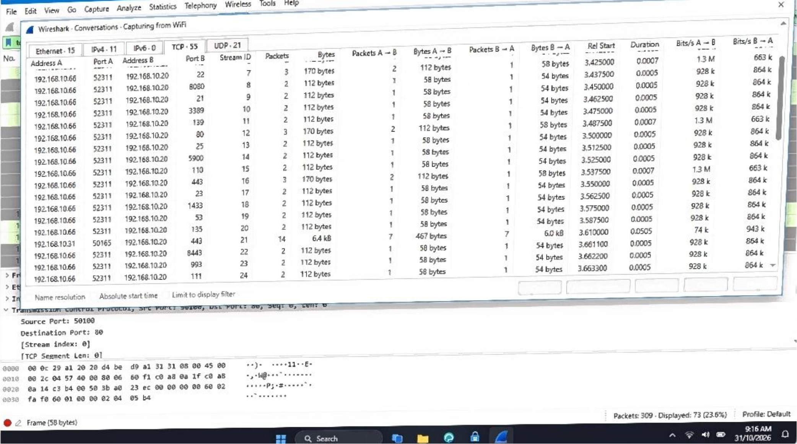

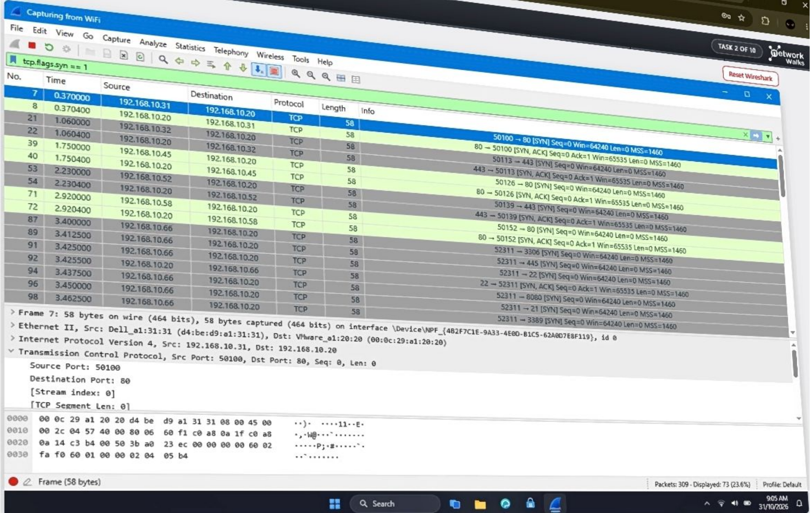

**Result: 90 / 100.** I lost 10 marks on task 2, "Show only SYN packets". I typed `tcp.flags.syn == 1`. That filter also matches the SYN,ACK replies from the server, so it does not show only the scanner's SYN packets. I have not checked the lab's answer key, but the likely fix is `tcp.flags.syn == 1 && tcp.flags.ack == 0`.

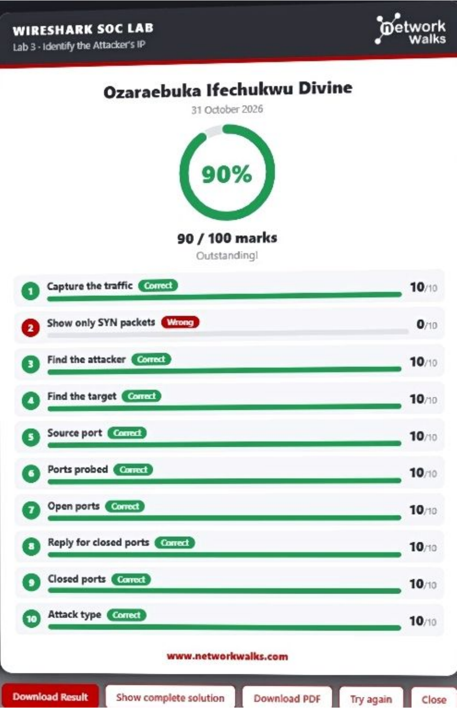

## Lab 4: Follow TCP Stream

**What it is meant to do:** a manager says some staff use an old office chat tool that sends messages in plain text. I capture the traffic and use Follow TCP Stream to read the chat and see what was shared.

**What I found**

- Most traffic is web (port 80 and 443). The chat tool runs on TCP port 5000, so I filtered with `tcp.port == 5000` (246 packets captured, 24 shown).
- The chat was started by 192.168.10.45, in TCP stream 5.
- The whole conversation was 413 bytes: 4 client packets, 5 server packets, 9 turns.
- In Follow TCP Stream, text sent by the client (the PC that started the chat) is red.
- The chat was readable by anyone on the network. It included a staff member asking for help with the Finance drive and passwords being shared in plain text. I have left the passwords out of this README and the screenshots.

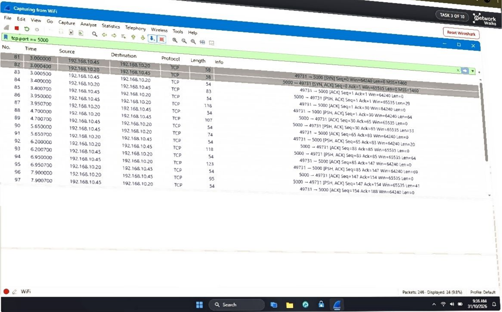

**Result: 100 / 100.**

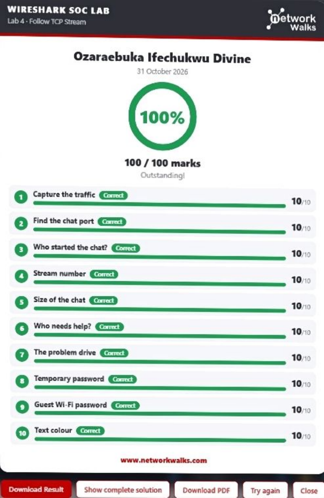

## Lab 5: Follow TCP Stream, part 2

**What it is meant to do:** a staff member browsed the company intranet and an admin thinks someone left a secret inside one of the web pages. I capture the traffic and use Follow TCP Stream to find the hidden text.

**What I found**

- 282 packets captured. The `http` filter showed 30 of them, which is every page request and response.
- Five pages were opened. The hidden note was on `/staff.html`, in TCP stream 7. The server replied 200 OK.
- The note was hidden in an HTML comment, so it never shows in a browser but is plain to see in the stream. It travelled server to client (the blue text).
- The second stream (stream 11) was a downloaded text file, `/download/report.txt`. Following it showed who prepared the report.
- I have not reproduced the access code from the comment here.

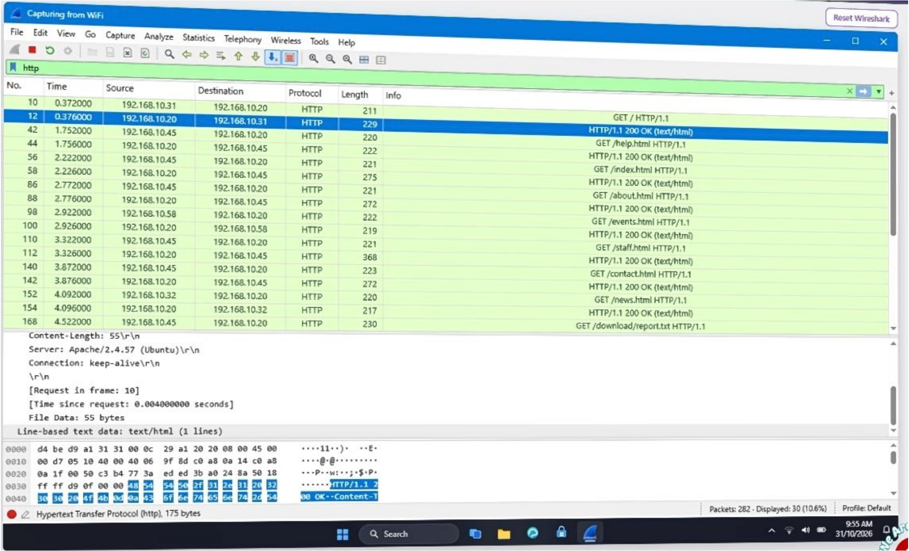

**Result: 100 / 100.**

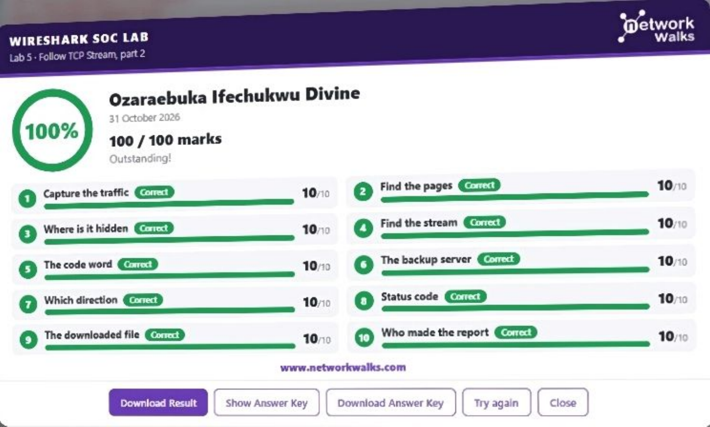

## Lab 6: HTTP plain text credentials

**What it is meant to do:** an old staff portal still runs on plain HTTP. I capture the traffic and find out what a person on the network can read from a sign-in that is not encrypted.

**What I found**

- 255 packets captured. `http.request` shows only the requests (13 of them).
- The sign-in used the POST method, to the page `/login`, from 192.168.10.45.
- There were 2 sign-in attempts. The second one worked.
- In the packet details pane, the line "HTML Form URL Encoded" holds the typed username and password in clear text. The username was `farhan.k`. I have not printed the password.
- The fix is HTTPS, so the form data is encrypted on the wire.

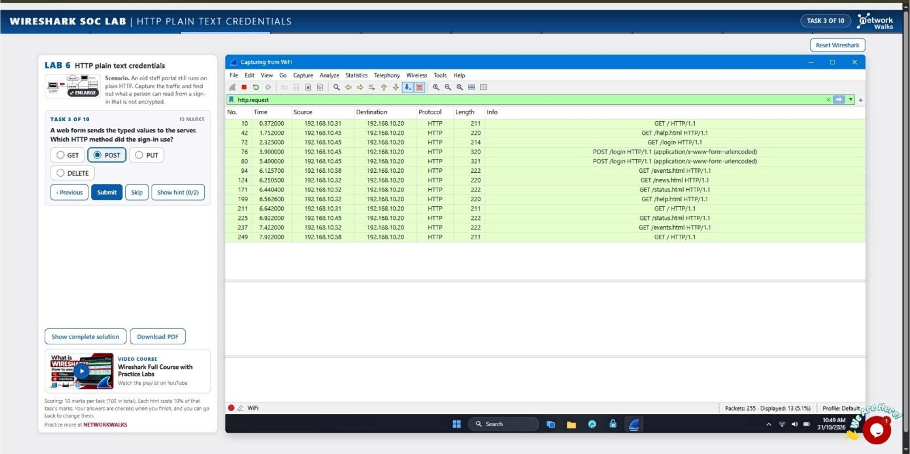

**Result: 100 / 100.**

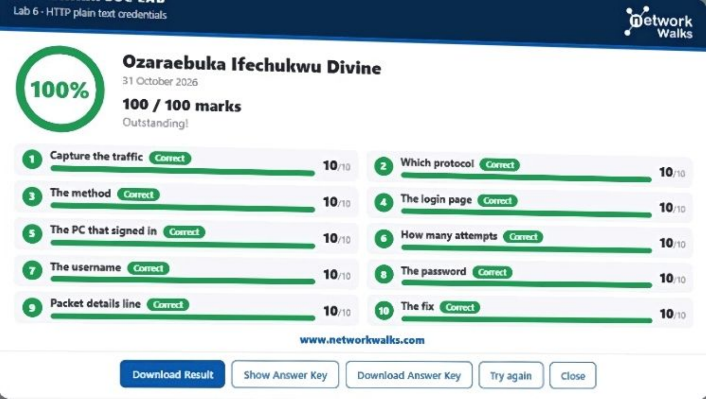

## Lab 7: Brute force catch

**What it is meant to do:** an FTP server owner reports many failed sign-ins in the last few minutes. I capture the traffic, find who is guessing passwords, and whether the attacker got in.

**What I found**

- 369 packets captured.
- Statistics > Protocol Hierarchy showed FTP made up 117 of them, which is how I confirmed the protocol under attack.
- Attacker: 192.168.10.66. FTP server: 192.168.10.20.
- The attacker kept trying the username `admin` with different passwords.
- 24 failed logins. Failed logins get "530 Login incorrect". The "331 Please specify the password" replies are the server asking for the password, not a failure.
- One attempt got "230 Login successful", so the attacker got in. The attack type is brute force.
- I used `ftp.request` and `ftp.response` to separate what the attacker sent from what the server answered.

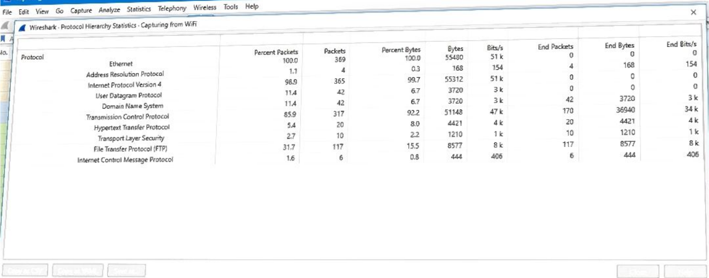

**Result: 100 / 100.**

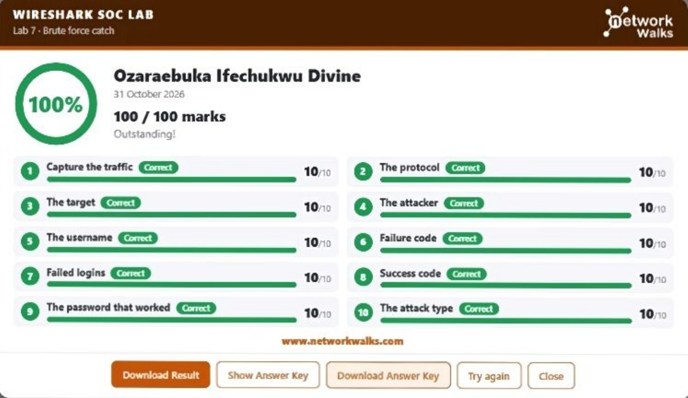

## Lab 8: VoIP call replay

**What it is meant to do:** a phone call was made through the company VoIP system. I capture the traffic, find the call, and play it back to learn what was said.

**What I found**

- 1051 packets captured.
- SIP sets the call up. The `sip.Call-ID` filter showed the whole call flow: INVITE, 100 Trying, 180 Ringing, 200 OK, ACK, and later BYE and 200 OK to end it.
- RTP carries the voice itself, as many small packets (one every 60 ms).
- The codec was G.711 PCMU, shown in the SDP part of the INVITE.
- The call was from 192.168.10.45 to 192.168.10.52. In the SIP header, "To" showed who answered.
- The RTP Player (Telephony menu) played the call back. The conversation, including something sensitive that was spoken aloud, could be heard by anyone who captured it. I have left that detail out.
- The fix: encrypt the call with SRTP.

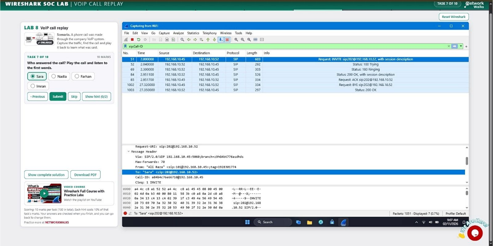

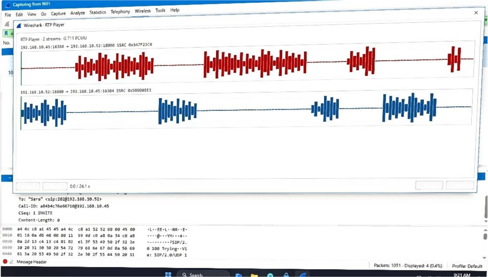

**Result: 90 / 100.** I got task 4, "Caller extension", wrong. The caller's extension is in the "From" line of the INVITE.

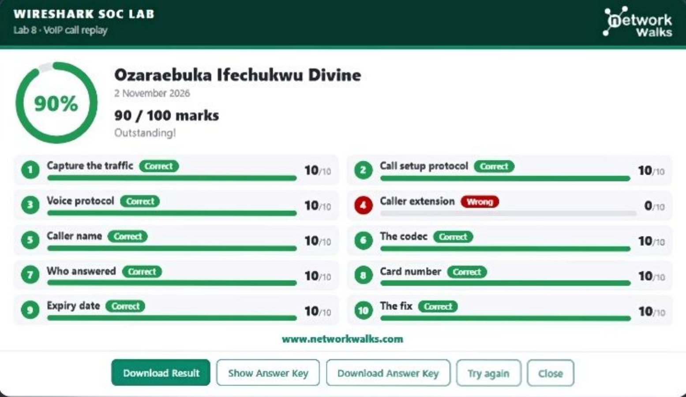

---

## Display filters I used

| Filter | What it does | Lab |
|---|---|---|
| `tcp.flags.syn == 1` | Shows packets with the SYN flag set (used to spot the scan) | 3 |
| `tcp.port == 5000` | Shows only traffic to or from TCP port 5000 | 4 |
| `tcp.stream eq 5` | Shows one TCP conversation by its stream number | 4, 5, 6, 7 |
| `http` | Shows all HTTP traffic | 5, 6 |
| `http.request` | Shows only HTTP requests (GET, POST) | 6 |
| `ftp.request` | Shows what the FTP client sent (USER, PASS) | 7 |
| `ftp.response` | Shows what the FTP server answered (530, 331, 230) | 7 |
| `sip.Call-ID` | Shows the SIP messages that make up a call | 8 |

## Wireshark features I learnt

| Feature | What it does |
|---|---|
| Start/stop capture | Records packets from the network interface (it showed as "WiFi" in the lab) |
| Packet list, details, bytes panes | Top: one line per packet. Middle: the layers of the selected packet. Bottom: the raw bytes |
| Status bar | Shows packets captured and packets displayed after a filter |
| Right-click > Follow > TCP Stream | Rebuilds a whole conversation as readable text (client in red, server in blue) |
| Statistics > Conversations | Lists who talked to whom, with packet counts |
| Statistics > Protocol Hierarchy | Shows what share of traffic is each protocol |
| Telephony menu > RTP Player | Plays back a captured VoIP call |

## What the traffic taught me

- Open ports answer SYN with SYN,ACK. Closed ports answer with RST,ACK. That difference is how a scan is read.
- A single source hitting many destination ports is a port scan. A single source repeating logins against one service is brute force.
- HTTP, FTP, plain chat and unencrypted VoIP are all readable by anyone who can capture the traffic. HTTPS, SFTP and SRTP are the fixes.

---

## What went wrong

1. **Lab 3, task 2.** I used `tcp.flags.syn == 1` for "show only SYN packets" and lost 10 marks. A filter that works is not the same as one that answers the question exactly.
2. **Lab 8, task 4.** I got the caller extension wrong. I should have read it straight from the "From" line of the INVITE instead of working from the wrong field.

---

## Security & Ethical Use Only

All traffic in this project came from the Networkwalks lab, which uses simulated traffic and fictional users and passwords. The only data I captured was inside that lab. Do not capture traffic on networks you do not own or have written permission to test. The passwords and card details shown in the lab are fictional and I have left them out on purpose.

---

## Tools & Resources

- Wireshark (on a Windows 11 PC inside the lab)
- Networkwalks Wireshark SOC Lab (https://www.networkwalks.com)
- Wireshark Full Course with Practice Labs (video playlist linked from the labs)

---

## Author

**Ozaraebuka Ifechukwu Divine**
Cybersecurity Professional B084
LinkedIn: https://www.linkedin.com/in/ozaraebuka-ifechukwu-7a4b06402

## About me

I am a Computer Science student at the Federal University of Technology, Owerri (FUTO), working towards a career as a SOC analyst. I am doing the Networkwalks Cybersecurity Internship (25 October to 22 November 2026) and keeping a repository for each lab I complete.

**Program:** Cybersecurity Internship, Networkwalks IT Solutions & Training
**Instructor:** Waqas Karim, CCIE

**A note on credit:** the lab scenarios and tasks are Networkwalks' work. The captures, the filters I used, the answers, and the write-up are mine.
